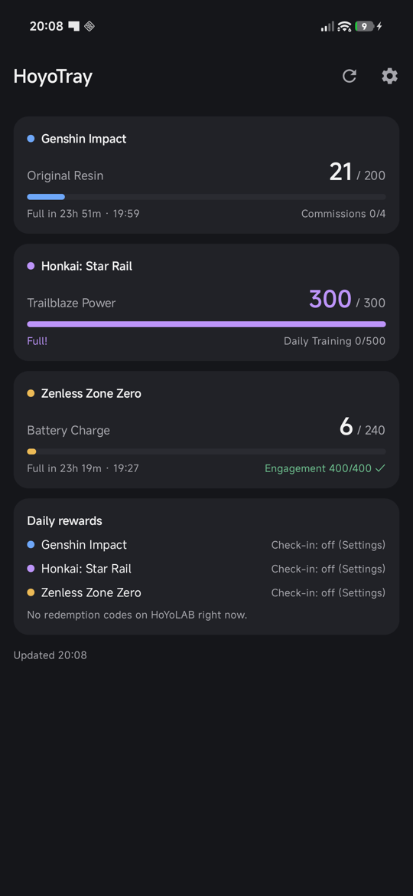
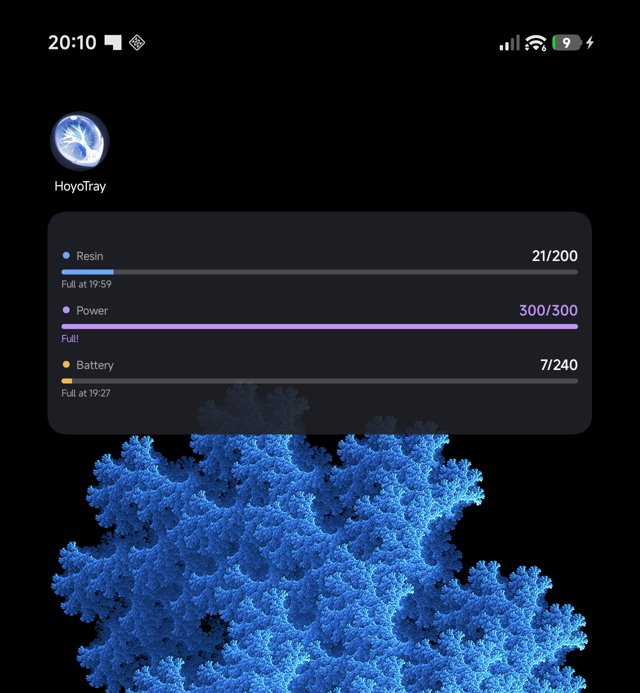

# HoyoTray for Android

[](../../releases/latest)
[](LICENSE)


Your **Genshin Impact Original Resin**, **Honkai: Star Rail Trailblaze Power** and
**Zenless Zone Zero Battery Charge** on your phone and home screen, from HoYoLAB's Real-Time Notes.
Optional automatic HoYoLAB daily check-in and redemption codes.

The Android companion of [HoyoTray for Windows](https://github.com/hanbay41/HoyoTray).

<p align="center">
  
  &nbsp;&nbsp;
  
</p>

## Features

- **Main screen**: a card per game and account with the current value, a progress bar,
  "Full in 7h 44m · 23:40" and commissions / daily training / engagement
- **Home-screen widget**: always shows sensible numbers. It works from the last fetched data and
  recalculates regen itself, so it never sits blank waiting for the network, and shows the time each one caps
- **Daily rewards** (per game, in Settings):
  - Daily check-in, claimed automatically once a day (off by default)
  - Redemption codes posted on HoYoLAB (livestream codes): *Notify* (default) with a
    **Redeem** button on the notification, *Auto*, or *Off*
  - If HoYoverse asks for a security check, the app opens the official page so you can finish it yourself
- Several accounts per game, pick which games to show
- Background refresh every 30 minutes; light/dark theme

## Install

1. Download `HoyoTray.apk` from the [latest release](../../releases/latest) on your phone and open it.
2. Allow installing from your browser / file manager when Android asks.
3. Open HoyoTray and log in to HoYoLAB: close the topic popup, tap **Log in**, sign in.
4. In HoYoLAB → Battle Chronicle → settings, make sure **Real-Time Notes** is enabled for each game.
5. Long-press your home screen → Widgets → **HoyoTray** to add the widget.

### Keep it running in the background

Android limits background apps; some brands (Xiaomi, Samsung, Huawei, Oppo...) very aggressively.
In HoyoTray → Settings → **Background**:

- **Allow running in the background** (battery optimisation exemption)
- On Xiaomi / Redmi / POCO: turn on **Autostart** and set Battery saver to **No restrictions**

Without this the widget still shows correct "full at" times, but numbers and check-ins may lag.

## Build from source

Requires JDK 17 and the Android SDK (platform 36).

```
./gradlew assembleDebug
```

## Privacy

- Your HoYoLAB login is stored only on your phone, encrypted with a key in the Android Keystore.
- It's sent only to HoYoLAB / HoYoverse servers. Nothing else is contacted.
- Logging out in Settings deletes it.

## Limitations

- Uses HoYoLAB's **unofficial, undocumented** API; HoYoverse can change it at any time.
- Read-only by default. Daily check-in and code redemption are automated actions on your account
  (the same requests the official web pages send); they're off / notify-only unless you enable them.
- Global (HoYoLAB) servers only.
- Only codes posted on HoYoLAB are found, mainly livestream codes.

## Disclaimer

Not affiliated with or endorsed by HoYoverse. Genshin Impact, Honkai: Star Rail, Zenless Zone Zero
and related names and artwork are trademarks and copyrights of HoYoverse. The resin artwork used for the
app icon is HoYoverse artwork and is **not** covered by this project's license.

## License

The source code is released under the [0BSD license](LICENSE): do whatever you want with it,
no attribution required, no warranty.
